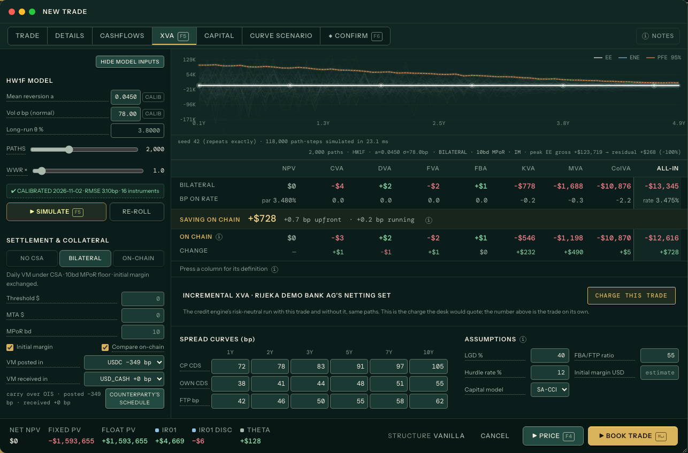

# Rijeka

[](https://github.com/MikoDevedzic/rijeka/actions/workflows/ci.yml)
[](https://github.com/MikoDevedzic/rijeka/releases)
[](LICENSE-APACHE)
[](LICENSE-BSL)
[](https://app.rijeka.app)

**The black box, opened.** Rijeka is one open system for all of trading: every asset, from the ticket to risk to operations, in code anyone can read, check and make their own. One taxonomy for risk, one record for a trade, one methodology that names the module behind every number: a common language a desk, its counterparty and its regulator can all read.

**Live today:** rates, FX and digital-asset derivatives, with pricing, risk, XVA, P&L and bilateral confirmation anchored on Sepolia, Ethereum's test network (the hosted demo runs there; Ethereum mainnet is on the roadmap). **Next:** credit, fixed income, equities, commodities, and the operations that follow a trade. Free to run for your own desk. The engine and the standard are open source under Apache-2.0; the platform's source is open under the Business Source License 1.1 (free to run and to change for your own organisation, for teaching and for research, not to be resold as a service) and each version becomes Apache-2.0 four years after it is published.

Most of the world's derivatives intelligence sits behind proprietary systems at a handful of large banks. Smaller institutions, emerging-market participants and academic researchers operate blind, without the tools to price, hedge or understand the true cost of a trade. Rijeka exists to change that.

Named after a village in Bosnia (*rijeka* means "river" in Bosnian, Croatian and Serbian), it is built on the belief that the mathematics of modern finance should be accessible to anyone with the ambition to use it.



*A swap ticket's XVA tab: the exposure paths, the waterfall under a bilateral CSA, and what confirming on chain saves.*

**Try it** at [app.rijeka.app](https://app.rijeka.app) (price a trade with no account; sign up and a sandbox desk is created for you) · **run it** with one `docker compose` command ([SELF-HOSTING.md](SELF-HOSTING.md)) · **read it**: the [methodology](docs/methodology/rijeka_methodology.pdf), the [validation](docs/VALIDATION.md), the [map of the system](docs/architecture.md) · **check it**: [contribute or validate](CONTRIBUTING.md).

---

## How it is built

Rijeka is built by one person, a derivatives pricing and model validation practitioner, working with an
AI coding assistant (Claude Code). Most of the code was typed by the assistant. What it computes, and
what counts as correct, was not left to it.

The rule of the project is that no number is trusted because the code produced it:

- **An independent reference.** Every product is repriced in QuantLib on every commit: more than 400
  comparisons in `backend/tests/reference`, each with a tolerance that fails the build when exceeded.
- **A second implementation you can read.** Each priced product has an Excel workbook that rebuilds
  the trade in cells with live formulas and compares every figure with the engine's. The XVA of a
  swap, and of a currency or digital-asset forward or option, has one too, with the simulation
  rebuilt path by path. The app exports them from your own market data.
- **A written method.** The [methodology](docs/methodology/rijeka_methodology.pdf) states each formula
  and names the module that implements it. The [model inventory](docs/model_inventory.md) lists every
  model, how it is checked, and what is still open.
- **Gates on every change.** About 2,000 Python tests, 900 frontend tests and 230 browser journeys run
  on every pull request. A change that moves a pinned figure has to explain the movement. Each change
  is also read cold by separate reviewers (independent, security, model, database, design), which are
  AI reviewers given the change and none of the author's reasoning. Their briefs are in
  `.claude/agents/` and the rules they hold are in `CLAUDE.md`.

What this does not make it: the hosted demo runs on synthetic rates, several inputs are stated proxies,
and no outside party has validated the models yet. [docs/VALIDATION.md](docs/VALIDATION.md) says what
is checked against what.

If you think a number is wrong, open an issue with the trade. That is the most useful thing anyone can
send, and whoever finds one is credited by name.

## What is live

Hosted demo at [app.rijeka.app](https://app.rijeka.app); the in-app **ROADMAP** is the honest status of every item (DONE means in the code and tested).

- **Pricing.** OIS bootstrap per currency (SOFR, €STR, SONIA, SARON, TONA, AONIA, CORRA); IRS, OIS and basis swaps; European swaptions (Bachelier on a β=0 SABR surface); caps, floors and collars; Bermudans on a Hull-White trinomial tree; FX spot, forwards and NDFs on the G10 pairs and non-deliverable forwards on BTC, ETH and SOL on one interest-rate-parity model; FX and digital-asset options in six styles (European, American, digital, barrier, double barrier, touch) on one engine, each against its QuantLib counterpart.
- **Risk.** Key-rate IR01 ladders by bump-and-reprice with FX01 / CRY01, CRYBASIS01 and vega; historical-simulation VaR by full revaluation with the curves, spots and volatility surfaces as factors, the ladder VaR alongside; named stress; backtesting (Basel traffic light, Kupiec); limits with utilisation and breaches.
- **Valuation adjustments (XVA).** CVA, DVA, FVA (the funding cost FCA and the funding benefit FBA), ColVA, MVA and KVA under CSA presets with a margin period of risk; initial margin as an amount you set or the engine's own estimate (not an industry margin model).
- **Counterparty credit.** Netting sets on shared Hull-White and lognormal paths, real-world calibration from the stored history (synthetic for rates, public for spots) with historical block sampling, the CSA on the netted value, EE / EPE / PFE and credit limits.
- **P&L.** Attribution by sequential full revaluation (carry, cash, curves by bucket, spot, points, vol, residual), day / MTD / YTD, trader and controller sign-off, XVA P&L.
- **Confirmation on chain.** Canonical record (v2; v3 for options on a rate) → EIP-712 → registry on Sepolia; amend and terminate; a public verifier that trusts nothing of Rijeka's. Messenger with firms, rooms, trade cards and wallet countersigning; Telegram mirror.
- **Open box.** The methodology names the module for every formula; the Methodology tab exports an Excel replication per product from your own market data, the ticket rebuilt in cells with every number linked to its derivation and a Checks sheet against the engine; the XVA book carries the engine's own Monte Carlo draws.
- **Prometheus.** A read-only assistant inside the messenger: sees your book and the engine, never changes anything.

## Validation

Every product is repriced in QuantLib on every commit: more than 400 comparisons in `backend/tests/reference`, each with a tolerance that fails the build when exceeded. Around them, about 2,000 Python tests, 900 frontend tests, 230 browser journeys on a local stack and 16 Foundry tests on the registry contract, in six CI jobs that run on every pull request. What is validated against what, and the open findings ([#31](https://github.com/MikoDevedzic/rijeka/issues/31)–[#36](https://github.com/MikoDevedzic/rijeka/issues/36)), is in [docs/VALIDATION.md](docs/VALIDATION.md). Independent validators are wanted, named on the report and listed as contributors.

## Public tools

No login required, on [rijeka.app](https://rijeka.app): the IRS pricer with a draggable curve (`/irs`), the XVA simulator (`/xva`) and waterfall (`/xva_ee`), the SABR vol surface scenario (`/vol_surface`), the Bermudan tree, the attribution tool, and the verifier (`/verify`). Their source is the landing site, deployed separately from this repository.

## Home

On a monitor the home is the trader's: where the book stands against its limits on one rail, the day's P&L, the risk by curve and bucket drawn against the limit that bounds it, what fixes on each coming day, what moved, what is on chain and what needs you. A phone keeps a simpler home, with the desk globe below.

With the policy path (on a monitor, the home's RATES tab), the next four decisions of the currency's central bank (FOMC, ECB, BoE, SNB, BoJ; published calendars in `backend/market_data/policy_path.py`) show what the curve prices for each: the forward overnight rate between consecutive meetings, the step in basis points against the window before, and the running total. Indicative, from the demo curve, not a forecast.

On a phone the home carries the **desk globe**: a turning Earth lit by the real sun, the five desks glowing while their session is open, every live trade drawn as an arc from your entity's home city to the counterparty's, and an orbital ring that holds one satellite per confirmation anchored on the registry. Beside it, chain health (latest block, relayer wallet, registry), an inbox of what needs your action (countersign requests, trades awaiting the other side, maturities inside 30 days, confirmations that never reached the chain, a low relayer wallet) and the latest anchors with their proof links. Land outlines are Natural Earth 110m (public domain); the globe is plain canvas, no 3D library.

**Relayer budget.** The hosted demo pays Sepolia gas from one relayer, so every anchoring action (confirm, countersign, amend, terminate, the chat-card countersign included) is charged to the person who pressed the button before anything is sent, and counted as an attempt, so a reverted or timed-out transaction still counts. Three rolling 24-hour caps: `RIJEKA_CHAIN_DAILY_LIMIT` per user (unset = off, for local and self-hosted), `RIJEKA_CHAIN_FIRM_DAILY_LIMIT` per firm (default three times the user cap), `RIJEKA_CHAIN_GLOBAL_DAILY_LIMIT` for everyone (default 200 once the user cap is set; with no cap set at all the budget is off and nothing is counted). Concurrent clicks serialise on an advisory lock. `RIJEKA_CHAIN_MAX_FEE_GWEI` (default 100) is a ceiling on the fee the relayer will pay; above it nothing is sent. Sends are serialised per process on the pending nonce, and a revert, a timeout or a used nonce is reconciled against the registry: if the record is already there, by this relayer or by the counterparty, it is taken as the anchor rather than retried into the same revert. Attempts are stored in `chain_attempts` (`docs/migrations/2026-10-31_chain_attempts.sql`), in memory until that table exists.

## Prometheus

The desk's quant, risk and margin analyst. Reads everything, changes nothing. Live today: read-only chat over your trades and the engine, in-app news summaries, and the **book brief** on the home page: the pricers compute a fact sheet (NPV and IR01 per trade, curve moves, pending confirmations, maturities, CSA terms, news tagged to the positions), Prometheus narrates it citing fact ids, and every number in the prose is checked against the sheet before it is shown; forecasting and advice are rejected. Next: scenario risk across the whole book, counterparty exposure and CVA commentary, margin against thresholds, a Telegram digest.

---

## Stack

| Layer | Technology |
|-------|-----------|
| Frontend | React + Vite |
| Backend | FastAPI (Python) |
| Database | Supabase (Postgres) |
| Deployment | Netlify (frontend) · Render (backend) |

---

## Getting started

**Run the whole thing.** One command brings up the database, sign-in, the API and the app ([SELF-HOSTING.md](SELF-HOSTING.md) has the settings to fill in first):

```bash
git clone https://github.com/MikoDevedzic/rijeka && cd rijeka
cp .env.selfhost.example .env.selfhost
docker compose --env-file .env.selfhost up --build
```

**Work on it.** The tests need no network and no hosted service ([CONTRIBUTING.md](CONTRIBUTING.md) has the local stack for the integration tests and the browser journeys):

```bash
cd backend && pip install -r requirements.txt -r requirements-dev.txt && python -m pytest -q
cd ../frontend && npm install && npm test
```

**Hosted demo.** [app.rijeka.app](https://app.rijeka.app) runs this code on the
Sepolia testnet. Price a trade and run its XVA as a guest, with no account. Sign up and a sandbox workspace is created for you: your own
entity, RIJEKA DEMO BANK AG as counterparty, the demo market data, trader role.
Book a swap, confirm it on-chain, and check the proof pack at
[rijeka.app/verify](https://rijeka.app/verify) — nothing in that check trusts
Rijeka's servers. Demo signatures for the demo bank are held by Rijeka and the
attestation says so (`bilateral: false`); a real counterparty countersigns with
its own wallet.

**Methodology.** The full model document, LaTeX and PDF, is in [docs/methodology](docs/methodology); the app's METHODOLOGY tab serves it and exports Excel replications per product from your own market data.

**Self-hosting.** Your curves, your trades, your keys, your Bloomberg seat:
see [SELF-HOSTING.md](SELF-HOSTING.md). The full schema is in
[docs/schema.sql](docs/schema.sql).

---

## Design principles

**No black boxes.** Every formula is documented, every number is traceable to the module that produced it, and every workbook shows its derivation.

**Institutional quality, open access.** The same mathematics used at tier-1 banks, available to anyone.

**One taxonomy.** IR01 not DV01; FX01 on a pair and CRY01 on a digital asset; on a digital asset IR01 is discounting only and CRYBASIS01 the forward basis; one aggregation.

**Audit-ready.** Every snapshot is stamped with its source and provenance; calibrations are stored with their fit diagnostics; every pricing change ships with a test and a before/after number.

---

## P&L and attribution

A `P&L` tab next to the blotter, and a tile on the desk home: day, month to date and year to date, each split into **market** and **trading** P&L, the attribution waterfall, the roll-up desk → book → trade with every trade's explain rows, and sign-off.

Attribution is **sequential full revaluation**, never a sensitivity estimate. Starting from yesterday's mark on yesterday's market, the valuation is moved one thing at a time in a fixed, stated order and each step is one row: carry (the date roll on the prior market), cash settled, each curve by tenor bucket (0-1Y, 1-5Y, 5-10Y, 10Y+; discount, forecast, then base), spot, quoted forward points, residual. Rows sum to the total by construction. New trades carry their close mark; unwinds remove the prior mark plus any fee. Marks are the production pricers on the saved market of each date, so the P&L page and the ticket agree to the cent.

End of day (`POST /api/pnl/eod`, and daily by cron for every account whose firm has the P&L module on) stores one mark per trade and one attributed row per trade per date, so MTD and YTD are sums of what was signed. Sign-off is trader first, then P&L controller or desk CFO (the `controller`, `cfo`, `admin` role, or a firm admin); a FINAL day is visible to management with the comments (`GET /api/pnl/firm`, the MANAGEMENT view). The history tables are `docs/migrations/2026-10-30_pnl.sql`; until applied, the report is computed live and says so.

## Market risk

A `RISK` tab next to P&L, and `Configurations › Market Risk` for the risk manager.

- **Ladder.** Key-rate IR01 by curve and tenor bucket (0-1Y, 1-5Y, 5-10Y, 10Y+, the same buckets as the P&L explain), by bumping each bucket 1bp and repricing every trade through the production pricers; FX01 and CRY01 per asset from the pricers, vega per surface and bucket. Totals in the reporting currency.
- **VaR.** Historical simulation by full revaluation: each day's observed changes in the window (basis points per tenor, log returns for spots) shift today's market and every live trade is repriced on it; VaR is the empirical loss quantile, expected shortfall the mean beyond it, the horizon scales by √t. The ladder VaR (the same changes applied to the key-rate sensitivities) is computed alongside as the linear comparison, and the gap is reported as convexity. The firm chooses the headline method; confidence, horizon, window and minimum observations are its settings.
- **History.** Risk factors are the demo's own: rates history is made by the synthetic generator (a stated generator, no publisher's data), and spots are fetched from ECB reference FX and Coinbase daily closes, over a date range and stored as the template account's snapshots, which the daily rebuild extends. `risk-backfill.yml` builds and fetches two years on dispatch; a rates curve a desk has entered rows of its own for is kept as it is unless the desk asks for it to be replaced.
- **Stress.** Named scenarios by full revaluation: parallel ±25/±100bp, steepener, flattener, USD ±10%, digital assets ±30%, a combined risk-off.
- **Limits.** The risk manager (`risk` or `admin` role, or a firm admin) sets limits on any reported number: VaR and ES, IR01 total or per curve or bucket, FX01 / CRY01 per asset, NPV, any scenario's loss; scope book total, desk or book; a warning level. Utilisation and breaches show on the risk page and in the home inbox after the daily run.

Tables: `docs/migrations/2026-10-30_market_risk.sql`.

## Counterparty credit

`RISK › COUNTERPARTY CREDIT`: exposure against credit limits, the way market risk is VaR against limits. Every trade of a counterparty is valued on the same simulated paths (a Hull-White factor per currency, a lognormal factor per spot; each monthly step a block of daily changes from two years of stored history (the synthetic rates market's for rates, public closes for spots), the same block for every factor, or Gaussian shocks correlated from that history, the firm's choice), so netting is exact; the counterparty's CSA is applied to the netted value with the margin period of risk. Two measures, labelled: **real-world** for exposure (vols from history, mean reversion by policy, zero drift, historical correlations) giving EE, EPE, PFE at 95 / 97.5 / 99, peak and tenor buckets; **risk-neutral** for the XVA reserves through the XVA waterfall, which are reported on the P&L page (before and after XVA, netted by the firm's policy), not on the credit page. Credit limits on peak PFE, PFE by bucket, EPE and current exposure. RUN NOW computes in the background and stores per counterparty; the daily cron does every account. Method: `docs/ccr.md`; tables: `docs/migrations/2026-10-31_ccr.sql`.

## Risk taxonomy

One set of names on every ticket. Rate factors are per basis point; spot factors are per 1 %.

| Factor | Rates (IRS, swaption, cap/floor) | FX forward / NDF | Crypto forward | FX option | Crypto option |
|--------|-----------------------------------|------------------|----------------|-----------|---------------|
| NPV | settlement currency | quote currency | USD | quote currency | USD |
| IR01 | +1 bp on every rate curve | = IR01 DISC + IR01 BASE | IR01 DISC only | = IR01 DISC + IR01 BASE | IR01 DISC only |
| IR01 DISC | +1 bp on the discount curve only | +1 bp on the quote (settlement) curve | +1 bp on the USD curve | +1 bp on the quote curve | +1 bp on the USD curve |
| IR01 BASE / CRYBASIS01 | — | +1 bp on the base-currency curve | CRYBASIS01: +1 bp a year on the forward basis (a long forward gains), reported apart | +1 bp on the base curve | CRYBASIS01: +1 bp a year on the forward basis, reported apart |
| FX01 / CRY01 | — | PV for +1 % spot | PV for +1 % spot | FX01 | CRY01 |
| VEGA | swaption / cap surface, +1 bp normal vol | — | — | +1 vol point | +1 vol point |
| THETA | one day's carry | one day's carry | one day's carry | one calendar day | one calendar day |
| GAMMA | dollar convexity to ±1 bp | — (a forward is linear in spot) | — | spot gamma | spot gamma |
| XVA | HW1F Monte Carlo exposure → waterfall | lognormal forward exposure → the same waterfall | the same on the clock of the asset's vol regimes (a stress of days on a level of weeks), with the Basel cryptoasset add-on (SCO60.98 / 60.99) | on the exposure paths (ccr) | on the exposure paths (ccr) |

The names on screen: `IR01 DISC` is the key `IR01_DISC`; `SPOT01` in the limits catalogue is FX01 or CRY01 by asset.

## Market data

The home page carries **the week ahead**: central bank decisions and the releases a rates desk waits for (CPI, payrolls, GDP, unemployment) across USD, EUR, GBP, CHF and JPY, plus UST coupon auctions, with the last print and, once out, the actual and the surprise against it. Dates come from the agencies' published schedules (central banks, BLS, BEA, Japan's Statistics Bureau), the ONS API for the UK, and the usual slot, flagged, where a calendar is not machine-readable (euro area, Switzerland); actuals from BLS, ONS, Eurostat and the SNB, all keyless. There is no consensus column, because survey medians are a terminal product. `backend/market_data/calendar.py`, `GET /api/public/calendar`.

The hosted demo prices on **demo market data that is made or public, never on terminal data** (a vendor's data is licensed to a seat and cannot be redistributed) **and never on a licensed benchmark**. Every snapshot is stamped with its provenance and the app says so on the home page.

| Curve | Built from | Assumption |
|-------|-----------|------------|
| USD, EUR, GBP, CHF and JPY overnight curves (`USD_SOFR`, `EUR_ESTR`, `GBP_SONIA`, `CHF_SARON`, `JPY_TONAR`) | **synthetic**: one stated generator, `backend/market_data/synthetic_rates.py`. No published fixing, yield or quote is read | a parametric curve per currency with hand-set levels: on 17 November 2026 a curve is its parameters, and on every other business day three factors (level, slope, curvature) have walked from that day, slowly mean-reverting, on shocks drawn from a seeded hash. Today's curve, each day's overnight fixing and the history all come from the one function, and the methodology gives the recipe to the digit. The ids name the conventions each curve is bootstrapped with |
| BTC, ETH, SOL option vols and forwards | Deribit's public option marks, every 10 minutes: ATM, 25Δ risk reversal and butterfly per tenor; the forward of each listed expiry | read at 25 and 50 forward delta per expiry; ATM variance-linear and the skew time-linear onto ten tenors, flat beyond the last listed expiry; a three-point smile, so strikes outside 25 delta are an extrapolation (2 to 3 vol points low at 10 delta on test smiles) and a listed expiry between tenors can be up to a point off; the time of the marks is on every ticket |
| BTC, ETH, SOL fixings | Deribit's daily delivery price at 08:00 UTC, stored once a day and never overwritten; a desk's own entry for a licensed benchmark | a cash-settled trade settles on the fixing of the source its record names and on no other; until that fixing is stored its value is on the stored spot and marked provisional |
| Currency NDF fixings | none stored by a feed: a desk's own entry for the benchmark it is licensed for (Market data, the pair's Fixings tab) | a currency NDF settles on the fixing of the source its record names; until that fixing is stored its amount is on the stored spot of the fixing date and marked provisional |
| Swaption ATM vols, skew, cap vols, G10 FX vols | **synthetic** parametric surface | not market; shaped like one so SABR, XVA and scenarios work |

The generator lives in one place, `backend/market_data/synthetic_rates.py`, and the tick that writes each day's set (`POST /api/market-data/demo/tick`) runs from the scheduler. `GET /api/market-data/demo/sources` is public and lists what the demo prices on, with the generator's whole recipe. A self-hosted desk connects its own market data.

---

## Documentation

- `docs/methodology/rijeka_methodology.pdf` (source `.tex` beside it) — curves, every product, market and counterparty risk, XVA, on-chain confirmation, the QuantLib reference; the same file the app's Methodology tab serves
- `docs/VALIDATION.md` — the validation charter, what is validated against what, and the open findings
- `docs/market_risk.md`, `docs/ccr.md`, `docs/pnl_attribution.md`, `docs/xva.md` — the per-module notes behind the methodology chapters
- `docs/ops/deploy.md` — the deploy chain (API first on Render, then the app from the `release` branch)
- `docs/architecture.md` — the map of the pieces and the data flow of a trade; `docs/ops/environment.md` — every environment variable; `docs/model_inventory.md` — every model with its validation status; `docs/glossary.md` — the names on every screen; `CHANGELOG.md`

---

## License

**Apache-2.0** for the engine and the standard (`backend/pricing`, `backend/risk`, `backend/ccr`, `backend/pnl`, `backend/ipv`, `backend/chain`, `chain/`, the methodology, the schema, the tests, the validation reports) and **Business Source License 1.1** for the platform (API, database layer, frontend): free to run for your own organisation, free to teach and study, not to be offered to others as a hosted service without a commercial licence; each version becomes Apache-2.0 after four years. The market-risk, counterparty-credit and P&L engines (`backend/risk`, `backend/ccr`, `backend/pnl`) are Apache-2.0 with the pricing engine. Path table, every directory named, in [LICENSE](LICENSE); GitHub shows the licence as "Other" because the file is this dual text. © 2026 Rijeka LLC

Built by someone who spent a career inside trading floor infrastructure — pricing systems, risk frameworks, and margin engines — and believed the tools deserved to be free.
