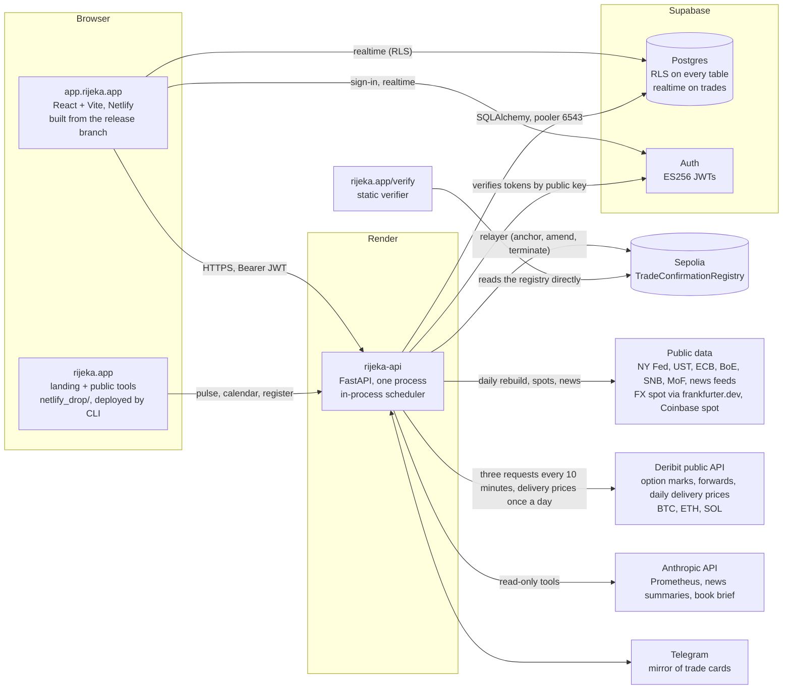

# Architecture

One repository, three hosted pieces, one chain. This page is the map, kept by the architect role (Nikola,
`.claude/agents/nikola.md`), who checks it against any change that adds a service, a data source, a table, a scheduled
job, a setting or a public endpoint; the per-module notes
(`docs/market_risk.md`, `docs/ccr.md`, `docs/pnl_attribution.md`, `docs/xva.md`, `chain/README.md`)
and the methodology (`docs/methodology/`) are the territory.

## The pieces

**The app** (`frontend/`): React 18 with Vite, a static build on Netlify. It talks to the API with the
user's Supabase JWT and subscribes to the `trades` table over Supabase realtime (filtered by row-level
security) so the blotter follows bookings and confirmations without a reload. Heavy libraries
(three.js, ExcelJS) and the secondary pages are code-split; the first screen after sign-in is the
blotter, the command centre and the messenger.

The Methodology page reads the methodology document in place. Its pages are not written in the app:
`frontend/scripts/build-methodology.mjs` (`npm run methodology`) makes
`frontend/src/components/docs/methodology/methodology.json` from the LaTeX source
(`docs/methodology/rijeka_methodology.tex`) and from `docs/model_inventory.md`, with the formulas set by KaTeX at
build time, and `build.test.js` fails when that file is not what the two sources now give. So there are three
prints of one source (the PDF by `tectonic`, the tracked copy the app serves under `public/methodology/`, these
pages) and a change to the `.tex` is finished when all three are rebuilt (`docs/ops/release.md` has the line). Each
section has an address (`/methodology/:section`). `katex` is a frontend dependency for this page alone: the build
script sets the formulas with it, and the browser loads only its stylesheet and fonts. The first page draws this
map (`architecture-data.js` restates it, and `architecture.test.js` holds its route names and batch cadences to the
API's own source; `Architecture.jsx` draws it with three.js through `lib/three.js`) and shows the API's public
health answer under it, fetched without a token. Nothing on the page is asked of the Rijeka API except the list of
workbooks and that health answer; the findings log reads GitHub's public issues, as it did. The System page
(`configurations/SystemPage.jsx`) reads the same health answer with labels of its own: two wordings of one body,
to be made one.

**The API** (`backend/`): one FastAPI process on Render (1 CPU, 2 GB, Virginia, the same AWS region
as the database). Sync routes run in Starlette's thread pool; pricing is numpy/scipy on the request
path with curve and trade caches. Routers by area: `api/routes/` (trades, booking, legs, events,
cashflows, pricer, xva, risk, ccr, capital, collateral, modules, ipv, pnl, chain, chat, trade cards, market data, demo provisioning,
methodology, ops, usage, csp, public). Engines: `pricing/` (curves, every product, XVA, initial margin, SA-CCR),
`risk/` (ladder, VaR, stress, backtest, limits, vol history), `ccr/` (exposure paths, calibration,
options on the paths), `pnl/` (marks, attribution, XVA P&L), `collateral/` (the firm's instrument list, the schedule per counterparty, the regime and the
yields derived from them, the ticket's collateral onto a CSA, the book's collateral page; `docs/collateral.md`), `chain/` (canonical record, EIP-712
signing, attestation, keys, lifecycle guard, Telegram), `settlement/` (the fixings store and the one settlement rule), `market_data/` (public-source demo feed, the venue adapter
`deribit.py` for digital-asset vols and forwards, policy path, calendar), `news/`, `prometheus/` (read-only assistant and book brief), `methodology/` (Excel
replications). `scheduler.py` runs the batches in-process (digital-asset marks every 10 minutes; digital-asset fixings, news,
summaries and spots every 30 minutes; demo market data, end-of-day P&L, market risk and counterparty
credit every 2 hours) and moves the `release` branch after a deploy.

**The database**: a Supabase project. Auth issues ES256 tokens; the API verifies them against the
project's published keys (no shared secret) and then reads the caller's role from `profiles.role`: an account
with no profile row, or whose row cannot be read just then, is a viewer for that request; the role a token claims
for itself is never used.
Every business table carries `user_id` and row-level security; the API scopes every query by the
caller and, for firm views, by `firm_members`. The API connects through the transaction pooler
(port 6543). Schema: `docs/schema.sql` plus `docs/migrations/` in date order (see `SELF-HOSTING.md`).

**The chain**: `chain/src/TradeConfirmationRegistry.sol` on Sepolia. A confirmation is the keccak of
the canonical record signed by both parties under EIP-712 (for a leg of a package confirmed as one, the
keccak of the package record, which lists the legs' hashes); the API's relayer anchors it, pays the gas
from one funded wallet, and is budgeted per user, firm and platform (one anchor, one charge: a package
is one). The verifier at `rijeka.app/verify` is a static page that reads the registry directly; nothing
in it trusts Rijeka's servers.

The four ways a trade is confirmed, side by side:

| Route | Who signs for the counterparty | When the block is slow | Afterwards |
|---|---|---|---|
| `POST /api/chain/confirm/{id}` | Rijeka, a key it holds (a demo entity) | 202 after `RIJEKA_CHAIN_SYNC_WAIT_S`, then `chain/pending.py` | amend and terminate on chain |
| `GET /request` then `POST /countersign/{id}` | the counterparty's own system | waits in the request | amend and terminate on chain |
| the chat trade card | the counterparty's wallet | waits in the request | amend and terminate on chain |
| `POST /api/chain/confirm-package` | Rijeka, a key it holds; refused (422) for a counterparty with its own wallet, whose legs go one by one | waits in the request, up to the backend's three minutes; no 202, no pending row | one leg cannot be amended or terminated yet (409) |

A proof pack (`GET /api/chain/proof/{id}`) carries `canonical` (what was signed), `trade_hash` and the
attestation. For a leg of a package `canonical` is the package record and `trade_hash` its hash, and the
leg's own record and hash travel in `leg`.

**The landing site** (`netlify_drop/`, git-ignored, deployed with the Netlify CLI): rijeka.app, the
public tools (IRS pricer, XVA simulator and waterfall, SABR surface, Bermudan tree, attribution),
the verifier, terms and privacy. It reads the API's public endpoints (pulse, calendar, the register of
anchored confirmations). In the register `trade_hash` is the hash the registry holds (for a leg of a
package, the package's; the leg's own is `leg_hash`), so a link into the verifier or the registry is by
`trade_hash`. The verifier's source is `chain/verify/index.html` in the repository; the page at
rijeka.app/verify is the copy in `netlify_drop/verify`, which changes only when the owner deploys the
landing site, on its own schedule and not with the app's release. Since 11 November 2026 the two are the same
file (read back byte for byte after that day's second deploy): the live page checks a leg inside its package, and
the source has the link handling the live page had gained on its own (`#p=` a shared proof pack, `#hash=` a bare
hash from the public register). The page lists the registries it knows
by chain (`REGISTRIES`), and a proof or a link that names any other contract is read and reported in amber, never
as VERIFIED or ANCHORED, because whoever wrote the proof or the link chose that address (anyone can deploy a
registry and sign with keys of their own). A verdict is green only when the hash, both signatures and the chain
were all checked; a self-hosted copy of the page lists its own registry. A change to the
verifier is made in the source and copied to `netlify_drop/verify`; before a deploy of the landing site the two
are compared, and a difference that is not the change being shipped is resolved first, never overwritten. The
public site carries no SIMM tool and no SIMM claim (taken down the same day): ISDA SIMM is licensed and is not
included.

## Market data, source by source

Curves, spots, forward points and the FX and digital-asset vol surfaces are rows of `market_data_snapshots`, keyed by
account, curve id and date, each with a `source` that says where it came from. The swaption skew, the SABR parameters
and the cap vols have their own tables (`swaption_vol_skew`, `sabr_params`, `cap_vol_surface`). The pricers read an
account's latest row; the ticket prints the source of the forward points and of a venue's vol surface, and the date of
the spot and of the discount curve.

The table describes the template account, the one the feeds write to.

| What | Curve ids | From | How often | When the source is silent |
|---|---|---|---|---|
| OIS curves | `USD_SOFR`, `EUR_ESTR`, `GBP_SONIA`, `CHF_SARON`, `JPY_TONAR` | central banks and treasuries, an indicative spread over government par (`market_data/demo_feed.py`) | rebuilt every 2 hours, one row a day | the curve is skipped and keeps its last date. Health (`market_data`) watches `USD_SOFR` only; the others are named in the tick's `failed_sources` |
| FX and digital-asset spot | `{PAIR}_SPOT` | ECB reference rates through `api.frankfurter.dev`; Coinbase | 30 minutes; digital assets also with the marks, every 10 | the last spot stands. Health (`spots`) is green while any spot is being written, so it does not see an FX outage on its own |
| Digital-asset vols | `BTCUSD_VOL`, `ETHUSD_VOL`, `SOLUSD_VOL` | Deribit option marks, read at 25 and 50 delta per expiry (`market_data/deribit.py`) | 10 minutes | the last good surface stands, its own time in the source. Health (`crypto_marks`) reads that time and is red when the oldest of the three is over two hours old, or when an asset's current surface is not the venue's |
| Digital-asset forwards | `{PAIR}_FWD` | the same chain: the forward of each expiry over the index | 10 minutes, with the vols | as above. The index is checked against the spot fetched in the same run (5 %), or the last stored one (25 %); with no spot at all it is stored unchecked. A funding rate typed on the ticket wins over the points for that price |
| Digital-asset fixings | table `fixings` (not a snapshot curve): pair, date, source, value | Deribit's daily delivery price at 08:00 UTC (`market_data/deribit.py`), shared by every account; a desk's own entry for a benchmark (`POST /api/currency/fixings`), its own only | every 30 minutes while a date among the last ten is missing: every pass for six hours after 08:10 UTC for the day's own, then, as for an older hole, every third hour; nothing once every date is stored. `?force=1&count=N` on the tick backfills | a price is stored only within 15 % of the template's stored spot for that date (the day before or after where it has none), and only for dates the venue can have published; a stored fixing is never overwritten by the feed: a re-read that differs stores nothing and marks the date disputed. Health (`crypto_fixings`) is red when the latest is more than 36 hours behind, when any of the seven dates before it is missing, or while a date is disputed. An administrator fills or corrects a date (`POST /api/currency/fixings/correct`). Before the table exists nothing is stored and an expired trade is valued on the stored spot, marked provisional |
| Rates vols | `USD_SWVOL_ATM`; skew and cap tables | parametric (`market_data/demo_feed.py`); the ATM grid's level scaled by realised vol (`risk/vols.py`), skew and caps as built | rebuilt every 2 hours, one row a day | n/a: built, and labelled synthetic |
| G10 FX vols | `{PAIR}_VOL` for six pairs | parametric, level scaled by realised vol | rebuilt every 2 hours, one row a day | n/a: built, and labelled synthetic |

A run of the marks makes three requests to the venue and three for the spot. Every writer and what it may replace:

| Writer | Writes for | Replaces |
|---|---|---|
| Marks tick (`refresh_crypto`) | the template, then every demo account in one statement | only rows a feed wrote. An account's own entry for a digital-asset vol or forward curve, the template owner's too, stays in force until that account replaces it or hands the pair back to the feed, whatever its date |
| Daily rebuild (`refresh`) | the template | the template's row of the day for every curve it builds, whoever wrote it; a venue's surface is carried instead of the parametric one |
| Spot ticks (`currencies.tick`, and the marks tick) | the template | the template's spot of the day |
| Daily copy (`demo._copy_market_data`) | each demo account, and a new account at sign-up | nothing: it adds the template's latest row per curve when the account has none of that date, so for curves other than the venue's it supersedes an older own entry. A venue's row is not copied over an account's own entry. Terminal-sourced rows are never copied; hand-typed template rows are |
| Hand-back (`POST /api/currency/forward-curve/use-feed`) | the caller's account; for the template, also the demo accounts still on a copy of its own curve | nothing is deleted: today's row for a digital-asset pair's forward points is written with the account's current points under a feed label, which the next marks run replaces with the venue's; rows of earlier dates stay. Refused where the feed does not write to the account, or has no forwards for the pair yet |
| Fixings tick (`refresh_fixings`) | shared rows (`user_id` null), insert only | nothing: a differing re-read writes no value and sets `disputed_at` on the stored row; an agreeing re-read clears it |
| Fixing correction (`POST /api/currency/fixings/correct`, the admin role) | a shared row of origin CORRECTION, with its author and reason | the live shared row for that pair, date and source, which is kept and marked superseded: the one writer that replaces a shared fixing. It passes the feed's own checks unless `override_band` is sent (the band and the stored spot are skipped, the reason is at least 30 characters and is noted on the row); it answers 409 until `2026-11-09_signup_role.sql` is applied |
| Desk fixing (`POST /api/currency/fixings`) | the caller's own row | the caller's previous entry for the same pair, date and source, which is kept and marked superseded; never a shared row, and never a source the feed owns |

So a demo account's curves, FX spot and G10 vols are the day's first copy; only the digital-asset vols, forwards and
spot follow the template through the day.

`RIJEKA_DERIBIT=0` switches the venue off. The process that runs the batches (the scheduler is on) then removes the
venue's rows from the template and demo accounts at the next daily rebuild, and the parametric surfaces and the flat
funding rate return; a process that runs no batches, such as a developer's shell on the shared database, removes
nothing. The vol history then has gaps until the history backfill is run (`POST /api/risk/history/backfill` or the
`risk-backfill` workflow; it is not a scheduled step). What the venue sends is treated as untrusted: capped, bounded,
checked against the spot, and its text never repeated in a response. `GET /api/market-data/demo/sources` is public and
lists the providers of the curves and of the venue's surfaces with the latest date of each; it does not list the spot
providers.

## Fixings and settlement of digital-asset trades

A digital-asset forward or option is cash-settled against the settlement price source its record names
(`settlement_price_source`, hashed as typed in the canonical record; `chain/canonical.py` is not involved in any of
this). `backend/settlement/store.py` holds fixings in one table: a shared row per pair, date and source written by
the feed, and a desk's own rows over them. `backend/settlement/rule.py` is the one rule, used by the booked
valuation (`pnl/valuation.py`); the ticket's view of a booked trade (`currencies.price_booked`) answers from that
valuation from the fixing date on:

- the fixing of a trade is the stored row for its pair, its fixing date (a forward's valuation date, an option's
  expiration date) and exactly its named source, the caller's own row first; never another source's price;
- a booked valuation carries `state`: `LIVE` before the fixing date, `FIXED` from it (a forward is worth
  sign × N × (fixing − K), an option its payoff on the fixing, discounted to the settlement date), `SETTLED` from
  the settlement date (the mark is zero and the amount is reported);
- the amount is `provisional` with a reason: no fixing stored (the stored spot of the fixing date is used, as
  before the store existed), or a barrier or touch option whose knock state is not recorded and which the fixing
  does not itself decide (the amount is the one that holds if the barrier was never touched).

A forward's fixing date is a field on the ticket (the record's `valuation_date`): the settlement date for the
venue's morning price, one day earlier for a benchmark, editable from tomorrow, and no earlier than seven days
before settlement, to the settlement date (before its fixing date a forward is priced to the settlement date, an
error that grows with the gap). An option fixes at its expiry. Booking checks the pairing
(`settlement/sources.check_booked`, called by both booking routes and when a trade's terms are edited): trade
date < fixing date ≤ settlement date, at most seven days before it; a source the pair lists is booked with that
source's time; a name that reads like the venue's is refused for a desk's own source.

Each pair has two sources (`settlement/sources.py`): the venue's delivery price, stored automatically, and a
benchmark, which a desk enters itself. The venue's is offered on a ticket only where the feed is delivering that
pair; a record that names it is accepted anywhere. With either feed switch off the tick answers `enabled: false`,
the health check goes, stored fixings stay, tickets offer the benchmark, and a trade that names the venue's
source stays provisional until an administrator stores its fixing. The pairs answer names the one a ticket books when nobody chooses as
`settlement_default {source, time}`: the venue's where the feed is delivering that pair (both switches on, the
table present, a shared fixing within three days: `store.feed_delivering`, the one test), the benchmark
elsewhere. `fixing_default` stays the benchmark for older web clients. Not done yet: a settled trade keeps its
status, and no settlement event is written (the P&L explain shows the amount leaving as carry, with no cash line);
that is a separate change because it writes into every account each day.

The CURVE SCENARIO tab of a currency or digital-asset ticket (`trade-window/FxScenarioChart.jsx`,
`fx-scenario.js`) draws the pair's recent fixings and its forward curve, lets the curve be dragged by tenor or as a
whole, and reprices in the browser with the pricer's own closed form and the backend's interpolation of forward
points: an approximation, exact with no shock, labelled as one, and pinned to the backend by shared vectors
(`backend/tests/vectors/fx_scenario.json`, read by a test on each side). A ticket with further legs is seen as
one on the footer, CASHFLOWS and this tab (`trade-window/fx-package.js`): sums of what each leg's own price
carries, and one scenario read by each leg at its own settlement date; nothing is priced a second way, nothing
is asked of the API beyond each leg's price, and a package with a leg missing or of a style the closed form does
not price is not summed without it. A scenario fixing shows the settlement
amount by the rule above. A trade that is `FIXED` or `SETTLED` has no forward to shock: the tab shows the fixing
used, the amount and both dates as the API returned them. The API gives that answer only to a client that asks
for it (`states` on `POST /price`); a web client from before it is answered as it always was. Nothing the tab
shows is saved.

## Migrations in production

`docs/migrations/` holds every migration, one feature per file; the local stack and a self-hosted deployment apply
all of them (`backend/stack/apply.py`). The hosted database is changed by the deployed API itself, and only from an
approved list (`backend/db/migrate.py`):

- `backend/db/migrations_approved.txt` has one line per approved migration: file name, the sha256 of its bytes,
  flags, and who approved it, when, in their own words. `backend/db/approved/` holds a byte-identical copy of each
  approved file, made at approval (`python -m db.migrate --stage <file>`): the service's root directory is
  `backend/`, so nothing under `docs/` exists where it runs.
- at start-up, before anything asks whether a table is there, the API applies each approved file not yet in the
  ledger table `schema_migrations`, in file-name order, each in one transaction with its ledger row, under a
  transaction-scoped advisory lock taken without waiting, with a lock timeout of 5 s and a statement timeout of
  60 s. It stops at the first file that is missing, does not hash to its line, is refused or fails; later entries
  stay blocked. Nothing it does can fail the start; it can delay it (2 s for the ledger, 5 s per lock wait, 60 s
  per statement).
- a content guard refuses a file that drops, truncates, deletes or grants to the anonymous role unless its line
  carries the `destructive` flag, and refuses transaction control and session-wide settings always. It reads the
  text; it does not see inside function bodies or built-up statements, which is what the review of each entry is for.
- it runs only where `RIJEKA_MIGRATE` is on, or unset on Render, and outside Render it refuses a hosted database
  whatever the setting. A developer's shell, the worker and the tests never apply anything to the hosted
  database, although the local `.env` names it; the runner's own integration tests apply to `rijeka_test` only.
  (`stack/apply.py` is a rule, not a guard, for a hosted database named on its command line: that is how a
  self-hosted project is built.)
- `GET /api/ops/health` → `migrations` carries counts only (enabled, approved, applied, pending, problems,
  last_run); names and reasons are on `GET /api/ops/migrations`, admin only, with whether the sign-up role
  function is installed. `schema` still reports each optional migration from the catalogue itself.
- two ledgers exist and neither reads the other: `public.schema_migrations` (this runner) and
  `public.stack_migrations` (`stack/apply.py`, which builds a local or self-hosted database from every file). On
  a database built by `stack/apply.py`, turning the runner on runs the approved files again, which is harmless
  because each is safe to run twice, but it would replace a customised `handle_new_user`.

## Independent price verification

`backend/ipv` (inputs, tolerances, ladder, run, store) and `/api/ipv/*`; `docs/ipv.md`. The inputs list is derived
from what the trades in scope read; each input is laddered per pillar through the production pricers; an independent
mark gives each pillar a gap against the firm's tolerance; overrides are market-data events with their first-order
P&L, the full revaluation on apply gives the second order; the gate and the controller's sign-off write the official
P&L (`ipv_runs`, `pnl_signoffs` role IPV), which the trading P&L shows beside the flash. Tables in
`docs/migrations/2026-11-05_ipv.sql`; the run is a worker job (`ipv_run`).

## Market data and the consensus service (planned)

A market-data service with adapters behind one interface (venue feeds, a CSV/JSON importer, terminal feeds on a
self-host under the client's licence), time-stamped snapshots with lineage on every mark, data-quality gates on
the official close, and a second source per input for IPV by configuration. On top of it, the consensus
valuation service for crypto OTC: contributing desks upload end-of-day marks through the IPV independent-mark
route, the service computes a blinded trimmed consensus per pillar once a minimum number of contributors exists,
and each desk receives the consensus as its independent mark and its own deviation, never another desk's number.
The consensus methodology is published; contributors never pay; the service is described as a consensus
valuation service for IPV, not a benchmark.

## Supervision (planned)

Two layers. **Examiner mode**, a product feature for the firm: a `SUPERVISOR` role the firm grants to a named
examiner for a bounded period, read-only, scoped to what the firm chooses, every page view logged, and an exam
pack exported in one click (limits and breaches with their history, exposure profiles per counterparty, the
capital stack, IPV runs with overrides and sign-offs, the P&L sign-off trail, the model inventory with validation
status, the methodology). On a self-host the examiner signs into the firm's own instance. The regulatory reports
(EMIR, CFTC) stay in the official formats; the examiner view is additive. **A supervisory view across firms**, as
a pilot with a regulator's innovation arm: participating books valued on one open engine, aggregated by region,
counterparty type and product with firm names blinded, anchored by confirmed on-chain records a supervisor can
verify without trusting the operator. Consent and scope are the firm's, always, with an expiry.

## Module switches

A firm runs the modules it needs (`backend/modules.py`; `firms.modules`, `firms.modules_preset`, `module_events`;
`GET/PUT /api/modules`, the MODULES page under Configurations → Operations). A switch hides the module's pages,
tabs and Configurations items, sends a direct visit to one of its pages (`/pnl…`, `/risk…`) home, and makes the
nightly batches skip the firm's accounts (`pnl.eod_tick`, `risk.daily_tick`, `ccr.daily_tick`). It is not an
entitlement: the module's API routes stay callable, and its Configurations pages are hidden from the navigation
but still open by URL. Nothing is deleted, and switching back on resumes; what a batch did not compute while the
module was off is not backfilled, so a module's history starts when it is first on. Null, or the columns missing,
means every module on in the firm's row, which is what a firm that has never chosen has (every firm made before
9 November 2026 started that way); what a user
is answered is that, less what a demo holds for the admin role (next paragraph).

**Held for the admin role on a demo.** Capital is not part of the hosted demo. `modules.held()` names the modules
an instance keeps for the admin role: `RIJEKA_HELD_MODULES`, or `modules.ON_REQUEST` (capital) when it is unset; a
name in it that is not a module key holds the default as well, so a mistake never releases capital.
Where `RIJEKA_DEMO_PROVISION` is on (the default when the variable is unset), `modules.locked` answers those
modules for every user without the admin role (`profiles.role`, read on the request; when that read fails, the role
`verify_token` read up to 30 seconds earlier, else `viewer`; `is_on` has only the user id, so when that read fails
the account counts as a `viewer`). One list and one function decide, and this follows:
- `GET /api/modules` answers with them off whatever `firms.modules` holds, lists them under `on_request` and gives
  `contact`; the presets it offers have them off and every preset says so in its description; the changes it lists
  leave them out (the `module_events` rows are whole, and the admin role is shown them whole).
  `routes/modules._view` is the only place the answer for a user is composed.
- `PUT /api/modules` by someone they are held from never switches one on. A map keeps what the row says (the page
  sends them off because that is how they were answered). A preset that has one off switches it off, as its name
  promises; a preset that has one on leaves the row's value. Nothing asked for is refused: a page opened before a
  deploy still saves its other switches, and asking for a held module there does nothing. One save is turned away:
  when the firm's row cannot be read, a save by someone a module is held from answers 503 and writes nothing,
  because a failed read would otherwise pass for on. A save whose write fails also answers 503 and writes nothing,
  for any caller.
- `modules.is_on(uid, key)` is false for a held module unless the account has the admin role (`profiles.role`,
  read by the user id). No batch asks about capital today; were P&L, market risk or counterparty credit held, their
  nightly ticks would skip every account without the admin role. The role is read only for a held module, so the
  nightly ticks cost what they did.
- Provisioning writes a new firm's row as the signup preset has it (there is nothing before it to keep).

The frontend has no rule of its own: the tab, the Risk section and the route follow the answer as for any switch,
and the MODULES page shows the row as on request. It treats every module as on until `GET /api/modules` first
answers; a read that fails later keeps the last answer. After a 5xx, no answer at all or a body that is not JSON,
it asks again three times (3, 10 and 30 seconds
later), then only when something else asks: a page load or sign-in, a change of session, the top bar mounting again
(a move between the desk pages, the documents and Configurations), the home, or the Modules page; a 4xx is not
asked again by the timer; an answer, or a save on the Modules page, drops retries already queued. Before the first
answer a held module (its tab, its Risk section and its route) is visible, and a reload on `/risk/capital` draws the page
before the answer sends it home. A ticket open on a tab whose module then goes off returns to TRADE. The hold is a
presentation rule, like the switch, not an entitlement: `/api/capital` stays callable, and Risk → Collateral reads
it. With `RIJEKA_DEMO_PROVISION=0`, or `RIJEKA_HELD_MODULES=NONE`, nothing is held back. A request to see a held
module is met on a self-hosted desk; a grant per firm does not exist yet, and the admin role is not one (it also
opens the Users page, platform usage and the ops detail).

Presets: LAUNCH (book, value, the XVA charge and its saving on chain, confirm; P&L, the risk pages, capital,
collateral, reserves and IPV off), DEALER (everything), CORPORATE (book, confirm, P&L, the ticket's XVA), FUND
(everything but capital), CLASSROOM (everything; the chain's network is a deployment setting). All eleven modules
exist; none is a placeholder.

**The launch view.** A workspace provisioned for a sign-in that has no firm yet starts on LAUNCH
(`RIJEKA_SIGNUP_PRESET`, set where the firm is created in `api/routes/demo.py` and nowhere else, so an existing
firm is never changed; its P&L, risk and credit batches are therefore off from its first day). Provisioning always
creates a new firm of one and never joins an existing firm by name. `GET /api/modules` returns `view`: `launch`
while the last preset the firm chose is LAUNCH, `full` otherwise; switching single modules on (the preset is then
CUSTOM by name) does not end the launch view, choosing a full preset does. On the launch view the home page is four
next steps instead of the dashboard, the XVA tab opens in its simple view (settlement and collateral, SIMULATE, the
results; the model inputs one click away, and the request sent is the same in both views), and the roadmap
placeholders under Configurations are hidden. Who may switch modules: a profile admin anywhere; and, where every
sign-in gets its own sandbox firm (`RIJEKA_DEMO_PROVISION` on), the ADMIN member of a firm of one, who is the person
the sandbox was made for. In a firm with colleagues, and on a firm deployment, only the admin role can.

**Roles.** A new account is a viewer whatever its sign-up asked for (`docs/migrations/2026-11-09_signup_role.sql`;
before it the trigger took the role from the client's sign-up metadata); provisioning raises it to trader; where
`RIJEKA_DEMO_PROVISION` is on a user may switch their own role among trader, controller, risk and management
(`api/routes/me.py`), and only an admin assigns the admin role, or any role on a firm deployment.

## Data flow of a trade

1. **Price.** The ticket posts terms to `/price` (rates) or `/api/currency/forward/price` and `/api/currency/option/price` (FX and digital
   assets); the pricer bootstraps the account's latest snapshot (cached per curve, date and quotes)
   and returns NPV, the sensitivities in the desk's taxonomy (IR01, IR01 DISC, FX01 / CRY01, FUND01,
   vega, theta, gamma) and the cashflows.
2. **Book.** `POST /api/book/trade` writes the trade, its legs and the BOOKED event in one transaction
   (idempotent by key). A product trade (FX, digital asset, option) is one block of terms, no legs.
   A package of legs (a strip, a collar: the DETAILS tab of a currency or digital-asset ticket) is booked whole by
   `POST /api/book/package`: every leg a trade of its own, all in one transaction or none. The package has one
   trade ID (`TRD-12345678`) and each leg a leg ID under it (`TRD-12345678-1`, `-2`, ...); no row carries the
   bare ID, and each leg's `strategy` holds the structure, the trade ID and its place (`STRIP TRD-12345678 2/3`).
   That tag is defined once (`api/routes/_package.py`: the structures, the size, the format), written only by
   this route (the ordinary booking and edit routes refuse a `strategy` that reads as one), and read by the
   confirmation route and by the browser (`fx-legs.js`; `tests/test_package_tag.py` holds the two to each
   other). A package column is the cleaner home for it and needs a migration.
3. **Confirm.** Both parties derive the same canonical record from their own bookings; each signs the
   EIP-712 message (a demo entity's key is Rijeka's, a real LEI's is the firm's wallet); the relayer
   anchors the pair of signatures; the CONFIRMED event carries the transaction. The messenger's trade
   card is the same flow with wallet countersigning, mirrored to Telegram when configured.
   A package is confirmed as one record (`POST /api/chain/confirm-package`): each leg keeps its own UTI and
   canonical record; the parties sign, and the relayer anchors once, the package record (the two LEIs and the
   legs' hashes, `chain/canonical.package_payload`); every leg's CONFIRMED event carries its own hash, the
   package's hash and its place, written in one transaction after the anchor (the legs locked and checked again
   first). While every leg of a package is pending, `POST /api/chain/confirm/{id}` refuses one leg alone.
   Amending or terminating one leg
   of a package is refused for now (409), and for a counterparty with its own wallet the route answers 422:
   its legs are confirmed one by one, each a single-trade record with an anchor of its own. The route waits
   for the receipt in the request and has no pending-anchor path; the runbook for a slow or lost answer is in
   `docs/ops/deploy.md`.
4. **Mark and explain.** The daily batch stores a mark per trade, the attributed P&L rows, the risk
   report (ladder, VaR, stress, limits) and the counterparty-credit run; the pages open from the
   stored day and RECALCULATE reprices live. Prometheus reads the same tables through read-only tools.

## Deploy chain

`main` is protected (backend tests, frontend build, registry contract tests). Render deploys every
commit on `main` that touches the API: a file under `backend/` (`render.yaml`: `rootDir`) that is not
Markdown. The app builds from `release`, which is moved to the commit the live API reports on
`GET /api/ops/health` by the API itself at startup (with `RIJEKA_GITHUB_TOKEN`) or by the
`release-sync` workflow; a push with nothing under `backend/` (the frontend, docs, the verifier's page
under `chain/`, a workflow) lets `release` follow `main`'s head, by the one rule both of them use. The
full account, with the failure modes seen so far, is `docs/ops/deploy.md`. Environment variables:
`docs/ops/environment.md`. Production is looked at from the outside by the `watch` workflow
(`.github/scripts/watch.py`: public addresses, GET only, no secret), on GitHub's schedule, by hand and after a
deploy; what it checks and what it cannot is `docs/ops/monitoring.md`. Versions: `CHANGELOG.md`; the API reports its version and commit on
`/api/ops/health`.

## Local stack and tests

`backend/stack/` builds a Rijeka database on a plain PostgreSQL 16 with no Supabase and no Docker:
`auth_stub.sql` (the `auth` schema, `auth.uid()` and the roles the policies name, the realtime
publication), `apply.py` (the auth stub, `docs/schema.sql`, `docs/migrations/*.sql` in date order,
statement by statement with the file and line on any failure, recorded in `stack_migrations` so a
second run is a no-op), `seed.py` (two users, one firm, their entities and counterparties, and fixed
market data of 2026-11-02 for the template user: OIS curves, swaption and cap vol surfaces, FX and
digital-asset spots, vols and funding, an HW1F calibration), `keys.py` (an ES256 keypair and the
JWKS) and `token.py` (Supabase-shaped tokens signed with it). `./stack/up.sh` is the one command.
`RIJEKA_JWKS_FILE` makes `middleware/auth.py` read that JWKS instead of fetching the project's.

`backend/tests/integration/` runs the API against it: every product booked through
`POST /api/book/trade` with the app's own bodies and priced; the blotter, legs and tenancy (the other
user sees nothing, 404 by id); the XVA routes for rates, forwards and every option style with the
documented shape, seeds and vol modes; the risk, P&L and credit reports valuing every trade; the
methodology workbooks; confirmation with the `NullBackend` and verification; 401 and 403. Skipped
unless `RIJEKA_STACK_DATABASE_URL` is set. CI runs them on a `postgres:16` service (the `integration
tests` job) and smoke-tests the compose stack's `db` + `migrate` (the `self-host smoke` job).

`frontend/e2e/` runs the built app in a real browser on the same stack (`npm run e2e`, the CI job `browser
journeys`): PostgREST on the stack database serves the reads the app makes through supabase-js, a token minted with
the stack's key signs the browser in, and the journeys open every page, take the rates, FX and digital-asset tickets
from pricing through XVA, capital, booking and confirmation, and assert the layout (results on screen, nothing
clipped). A journey fails on any uncaught error, console error or failed API call (`frontend/e2e/README.md`).

`tests/integration/test_golden_book.py` is the pinned sample book: a fixed book on the stack's fixed market, valued
with fixed seeds, 66 figures compared with `golden_book.json`; a figure moves only with a dated line in
`GOLDEN_CHANGES.md`.

Who runs what, and when, is in `CLAUDE.md`: nine named roles (browser tester, numbers guardian, model validator, independent
reviewer, security reviewer, architect, database keeper, release manager, project manager) with their agent definitions in `.claude/agents/` and the release
checklist in `docs/ops/release.md`.

`docker-compose.yml` is the self-hosted deployment on the same scripts, with GoTrue for sign-in
(`SELF-HOSTING.md`).

## What runs where, honestly

- One API process, in-request Monte Carlo and full-revaluation VaR, rate-limited per account
  (`api/routes/_limits.py`). A larger book moves these to a worker without changing the engines.
- Job state for background runs (counterparty credit, the risk backfill) is in process memory until the
  stored row lands; a deploy mid-run loses the "running" flag, not the data.
- The hosted demo prices on public-source market data rebuilt daily and, for digital assets, on a venue's option
  marks refreshed every ten minutes; rates and G10 FX vol surfaces are synthetic, scaled by realised vol, and
  labelled as such. A self-hosted desk loads its own (and switches the feeds off: `docs/ops/environment.md`).

### The worker and the anchor in flight (3 November 2026)

The deploy chain has a second Render service, **rijeka-worker** (`render.yaml`, `python -m
worker`, created by a Blueprint sync once `docs/migrations/2026-11-03_jobs.sql` is applied). It
claims rows from the `jobs` table with `FOR UPDATE SKIP LOCKED` and runs the counterparty-credit RUN
NOW and the risk-history backfill off the API's CPU; the routes enqueue when the table exists and
`RIJEKA_WORKER` says a worker is expected, and start the in-process thread otherwise, so the API
runs unchanged before the migration or without the service. The daily batches and the release move
stay in the API process. The worker never touches the chain: the relayer nonce is the API's.
`GET /api/ops/health` reports the worker's last heartbeat and the queue depth under `worker`.

An on-chain confirm sends the transaction from the API and waits `RIJEKA_CHAIN_SYNC_WAIT_S` (25 s)
for the receipt; past that it stores the signed record and the transaction hash in
`pending_anchors`, answers 202, and `chain/pending.py` applies the one CONFIRMED transition when the
registry has the record (the scheduler's `chain_reconcile` step every cycle, and
`POST /api/chain/reconcile/{trade_id}`, which the trade window polls). A reverted or dropped
transaction leaves the trade PENDING with the reason recorded. Job state is therefore in the
database rather than process memory once the migration is applied, and a confirm request no longer
holds a request thread for three minutes.

