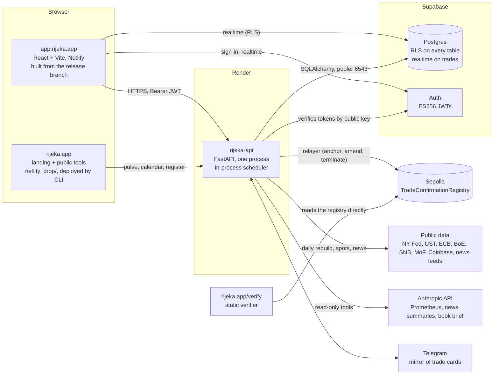

# Architecture

One repository, three hosted pieces, one chain. This page is the map; the per-module notes
(`docs/market_risk.md`, `docs/ccr.md`, `docs/pnl_attribution.md`, `docs/xva.md`, `chain/README.md`)
and the methodology (`docs/methodology/`) are the territory.

## The pieces

**The app** (`frontend/`): React 18 with Vite, a static build on Netlify. It talks to the API with the
user's Supabase JWT and subscribes to the `trades` table over Supabase realtime (filtered by row-level
security) so the blotter follows bookings and confirmations without a reload. Heavy libraries
(three.js, ExcelJS) and the secondary pages are code-split; the first screen after sign-in is the
blotter, the command centre and the messenger.

**The API** (`backend/`): one FastAPI process on Render (1 CPU, 2 GB, Virginia, the same AWS region
as the database). Sync routes run in Starlette's thread pool; pricing is numpy/scipy on the request
path with curve and trade caches. Routers by area: `api/routes/` (trades, booking, legs, events,
cashflows, pricer, xva, risk, ccr, capital, collateral, modules, ipv, pnl, chain, chat, trade cards, market data, demo provisioning,
methodology, ops, usage, csp, public). Engines: `pricing/` (curves, every product, XVA, SIMM, SA-CCR),
`risk/` (ladder, VaR, stress, backtest, limits, vol history), `ccr/` (exposure paths, calibration,
options on the paths), `pnl/` (marks, attribution, XVA P&L), `collateral/` (the firm's instrument list, the schedule per counterparty, the regime and the
yields derived from them; `docs/collateral.md`), `chain/` (canonical record, EIP-712
signing, attestation, keys, lifecycle guard, Telegram), `market_data/` (public-source demo feed, policy
path, calendar), `news/`, `prometheus/` (read-only assistant and book brief), `methodology/` (Excel
replications). `scheduler.py` runs the batches in-process (news, summaries and spots every 30 minutes;
demo market data, end-of-day P&L, market risk and counterparty credit every 2 hours) and moves the
`release` branch after a deploy.

**The database**: a Supabase project. Auth issues ES256 tokens; the API verifies them against the
project's published keys (no shared secret) and then reads the caller's role from `profiles.role`.
Every business table carries `user_id` and row-level security; the API scopes every query by the
caller and, for firm views, by `firm_members`. The API connects through the transaction pooler
(port 6543). Schema: `docs/schema.sql` plus `docs/migrations/` in date order (see `SELF-HOSTING.md`).

**The chain**: `chain/src/TradeConfirmationRegistry.sol` on Sepolia. A confirmation is the keccak of
the canonical record signed by both parties under EIP-712; the API's relayer anchors it, pays the gas
from one funded wallet, and is budgeted per user, firm and platform. The verifier at `rijeka.app/verify`
is a static page that reads the registry directly; nothing in it trusts Rijeka's servers.

**The landing site** (`netlify_drop/`, git-ignored, deployed with the Netlify CLI): rijeka.app, the
public tools (IRS pricer, XVA simulator and waterfall, SABR surface, Bermudan tree, attribution, SIMM),
the verifier, terms and privacy. It reads the API's public endpoints (pulse, calendar, the register of
anchored confirmations).

## Independent price verification

`backend/ipv` (inputs, tolerances, ladder, run, store) and `/api/ipv/*`; `docs/ipv.md`. The inputs list is derived
from what the trades in scope read; each input is laddered per pillar through the production pricers; an independent
mark gives each pillar a gap against the firm's tolerance; overrides are market-data events with their first-order
P&L, the full revaluation on apply gives the second order; the gate and the controller's sign-off write the official
P&L (`ipv_runs`, `pnl_signoffs` role IPV), which the trading P&L shows beside the flash. Tables in
`docs/migrations/2026-11-05_ipv.sql`; the run is a worker job (`ipv_run`).

## Market data and the consensus service (planned)

A market-data service with adapters behind one interface (venue feeds, a CSV/JSON importer, terminal feeds on a
self-host under the client's licence), time-stamped snapshots with lineage on every mark, data-quality gates on
the official close, and a second source per input for IPV by configuration. On top of it, the consensus
valuation service for crypto OTC: contributing desks upload end-of-day marks through the IPV independent-mark
route, the service computes a blinded trimmed consensus per pillar once a minimum number of contributors exists,
and each desk receives the consensus as its independent mark and its own deviation, never another desk's number.
The consensus methodology is published; contributors never pay; the service is described as a consensus
valuation service for IPV, not a benchmark.

## Supervision (planned)

Two layers. **Examiner mode**, a product feature for the firm: a `SUPERVISOR` role the firm grants to a named
examiner for a bounded period, read-only, scoped to what the firm chooses, every page view logged, and an exam
pack exported in one click (limits and breaches with their history, exposure profiles per counterparty, the
capital stack, IPV runs with overrides and sign-offs, the P&L sign-off trail, the model inventory with validation
status, the methodology). On a self-host the examiner signs into the firm's own instance. The regulatory reports
(EMIR, CFTC) stay in the official formats; the examiner view is additive. **A supervisory view across firms**, as
a pilot with a regulator's innovation arm: participating books valued on one open engine, aggregated by region,
counterparty type and product with firm names blinded, anchored by confirmed on-chain records a supervisor can
verify without trusting the operator. Consent and scope are the firm's, always, with an expiry.

## Module switches

A firm runs the modules it needs (`backend/modules.py`; `firms.modules`, `firms.modules_preset`, `module_events`;
`GET/PUT /api/modules`, the admin's MODULES page under Configurations → Operations). A switch hides the module's
pages and tabs, sends a direct visit to its route home, and makes the nightly batches skip the firm's accounts
(`pnl.eod_tick`, `risk.daily_tick`, `ccr.daily_tick`); the routes stay callable, the data stays, and switching
back on resumes with history intact. Null, or the columns missing, means every module on. Presets: DEALER
(everything), CORPORATE (book, confirm, P&L, the ticket's XVA), FUND (everything but capital), CLASSROOM
(everything; the chain's network is a deployment setting). Planned modules (collateral, XVA reserves, IPV) are
listed and not switchable until they exist.

## Data flow of a trade

1. **Price.** The ticket posts terms to `/price` (rates) or `/api/currencies/price` (FX and digital
   assets); the pricer bootstraps the account's latest snapshot (cached per curve, date and quotes)
   and returns NPV, the sensitivities in the desk's taxonomy (IR01, IR01 DISC, FX01 / CRY01, FUND01,
   vega, theta, gamma) and the cashflows.
2. **Book.** `POST /api/book/trade` writes the trade, its legs and the BOOKED event in one transaction
   (idempotent by key). A product trade (FX, digital asset, option) is one block of terms, no legs.
3. **Confirm.** Both parties derive the same canonical record from their own bookings; each signs the
   EIP-712 message (a demo entity's key is Rijeka's, a real LEI's is the firm's wallet); the relayer
   anchors the pair of signatures; the CONFIRMED event carries the transaction. The messenger's trade
   card is the same flow with wallet countersigning, mirrored to Telegram when configured.
4. **Mark and explain.** The daily batch stores a mark per trade, the attributed P&L rows, the risk
   report (ladder, VaR, stress, limits) and the counterparty-credit run; the pages open from the
   stored day and RECALCULATE reprices live. Prometheus reads the same tables through read-only tools.

## Deploy chain

`main` is protected (backend tests, frontend build, registry contract tests). Render deploys every
commit on `main` that touches the API (`render.yaml` ignores `frontend/`, `netlify_drop/`, `docs/`,
`*.md`). The app builds from `release`, which is moved to the commit the live API reports on
`GET /api/ops/health` by the API itself at startup (with `RIJEKA_GITHUB_TOKEN`) or by the
`release-sync` workflow; a frontend-only or docs-only push lets `release` follow `main`'s head. The
full account, with the failure modes seen so far, is `docs/ops/deploy.md`. Environment variables:
`docs/ops/environment.md`. Versions: `CHANGELOG.md`; the API reports its version and commit on
`/api/ops/health`.

## Local stack and tests

`backend/stack/` builds a Rijeka database on a plain PostgreSQL 16 with no Supabase and no Docker:
`auth_stub.sql` (the `auth` schema, `auth.uid()` and the roles the policies name, the realtime
publication), `apply.py` (the auth stub, `docs/schema.sql`, `docs/migrations/*.sql` in date order,
statement by statement with the file and line on any failure, recorded in `stack_migrations` so a
second run is a no-op), `seed.py` (two users, one firm, their entities and counterparties, and fixed
market data of 2026-11-02 for the template user: OIS curves, swaption and cap vol surfaces, FX and
digital-asset spots, vols and funding, an HW1F calibration), `keys.py` (an ES256 keypair and the
JWKS) and `token.py` (Supabase-shaped tokens signed with it). `./stack/up.sh` is the one command.
`RIJEKA_JWKS_FILE` makes `middleware/auth.py` read that JWKS instead of fetching the project's.

`backend/tests/integration/` runs the API against it: every product booked through
`POST /api/book/trade` with the app's own bodies and priced; the blotter, legs and tenancy (the other
user sees nothing, 404 by id); the XVA routes for rates, forwards and every option style with the
documented shape, seeds and vol modes; the risk, P&L and credit reports valuing every trade; the
methodology workbooks; confirmation with the `NullBackend` and verification; 401 and 403. Skipped
unless `RIJEKA_STACK_DATABASE_URL` is set. CI runs them on a `postgres:16` service (the `integration
tests` job) and smoke-tests the compose stack's `db` + `migrate` (the `self-host smoke` job).

`docker-compose.yml` is the self-hosted deployment on the same scripts, with GoTrue for sign-in
(`SELF-HOSTING.md`).

## What runs where, honestly

- One API process, in-request Monte Carlo and full-revaluation VaR, rate-limited per account
  (`api/routes/_limits.py`). A larger book moves these to a worker without changing the engines.
- Job state for background runs (counterparty credit, the risk backfill) is in process memory until the
  stored row lands; a deploy mid-run loses the "running" flag, not the data.
- The hosted demo prices on public-source market data rebuilt daily; synthetic vol surfaces scaled by
  realised vol, labelled as such. A self-hosted desk loads its own.

### The worker and the anchor in flight (3 November 2026)

The deploy chain has a second Render service, **rijeka-worker** (`render.yaml`, `python -m
worker`, created by a Blueprint sync once `docs/migrations/2026-11-03_jobs.sql` is applied). It
claims rows from the `jobs` table with `FOR UPDATE SKIP LOCKED` and runs the counterparty-credit RUN
NOW and the risk-history backfill off the API's CPU; the routes enqueue when the table exists and
`RIJEKA_WORKER` says a worker is expected, and start the in-process thread otherwise, so the API
runs unchanged before the migration or without the service. The daily batches and the release move
stay in the API process. The worker never touches the chain: the relayer nonce is the API's.
`GET /api/ops/health` reports the worker's last heartbeat and the queue depth under `worker`.

An on-chain confirm sends the transaction from the API and waits `RIJEKA_CHAIN_SYNC_WAIT_S` (25 s)
for the receipt; past that it stores the signed record and the transaction hash in
`pending_anchors`, answers 202, and `chain/pending.py` applies the one CONFIRMED transition when the
registry has the record (the scheduler's `chain_reconcile` step every cycle, and
`POST /api/chain/reconcile/{trade_id}`, which the trade window polls). A reverted or dropped
transaction leaves the trade PENDING with the reason recorded. Job state is therefore in the
database rather than process memory once the migration is applied, and a confirm request no longer
holds a request thread for three minutes.

