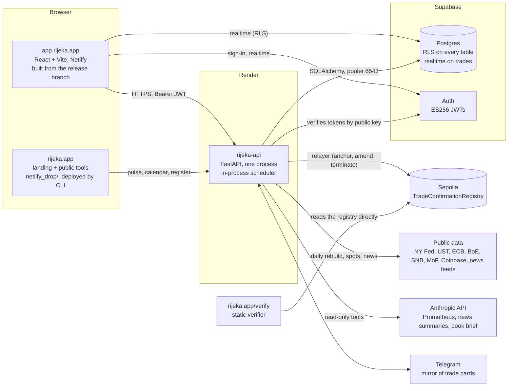

# Architecture

One repository, three hosted pieces, one chain. This page is the map; the per-module notes
(`docs/market_risk.md`, `docs/ccr.md`, `docs/pnl_attribution.md`, `docs/xva.md`, `chain/README.md`)
and the methodology (`docs/methodology/`) are the territory.

## The pieces

**The app** (`frontend/`): React 18 with Vite, a static build on Netlify. It talks to the API with the
user's Supabase JWT and subscribes to the `trades` table over Supabase realtime (filtered by row-level
security) so the blotter follows bookings and confirmations without a reload. Heavy libraries
(three.js, ExcelJS) and the secondary pages are code-split; the first screen after sign-in is the
blotter, the command centre and the messenger.

**The API** (`backend/`): one FastAPI process on Render (1 CPU, 2 GB, Virginia, the same AWS region
as the database). Sync routes run in Starlette's thread pool; pricing is numpy/scipy on the request
path with curve and trade caches. Routers by area: `api/routes/` (trades, booking, legs, events,
cashflows, pricer, xva, risk, ccr, pnl, chain, chat, trade cards, market data, demo provisioning,
methodology, ops, usage, csp, public). Engines: `pricing/` (curves, every product, XVA, SIMM, SA-CCR),
`risk/` (ladder, VaR, stress, backtest, limits, vol history), `ccr/` (exposure paths, calibration,
options on the paths), `pnl/` (marks, attribution, XVA P&L), `chain/` (canonical record, EIP-712
signing, attestation, keys, lifecycle guard, Telegram), `market_data/` (public-source demo feed, policy
path, calendar), `news/`, `prometheus/` (read-only assistant and book brief), `methodology/` (Excel
replications). `scheduler.py` runs the batches in-process (news, summaries and spots every 30 minutes;
demo market data, end-of-day P&L, market risk and counterparty credit every 2 hours) and moves the
`release` branch after a deploy.

**The database**: a Supabase project. Auth issues ES256 tokens; the API verifies them against the
project's published keys (no shared secret) and then reads the caller's role from `profiles.role`.
Every business table carries `user_id` and row-level security; the API scopes every query by the
caller and, for firm views, by `firm_members`. The API connects through the transaction pooler
(port 6543). Schema: `docs/schema.sql` plus `docs/migrations/` in date order (see `SELF-HOSTING.md`).

**The chain**: `chain/src/TradeConfirmationRegistry.sol` on Sepolia. A confirmation is the keccak of
the canonical record signed by both parties under EIP-712; the API's relayer anchors it, pays the gas
from one funded wallet, and is budgeted per user, firm and platform. The verifier at `rijeka.app/verify`
is a static page that reads the registry directly; nothing in it trusts Rijeka's servers.

**The landing site** (`netlify_drop/`, git-ignored, deployed with the Netlify CLI): rijeka.app, the
public tools (IRS pricer, XVA simulator and waterfall, SABR surface, Bermudan tree, attribution, SIMM),
the verifier, terms and privacy. It reads the API's public endpoints (pulse, calendar, the register of
anchored confirmations).

## Data flow of a trade

1. **Price.** The ticket posts terms to `/price` (rates) or `/api/currencies/price` (FX and digital
   assets); the pricer bootstraps the account's latest snapshot (cached per curve, date and quotes)
   and returns NPV, the sensitivities in the desk's taxonomy (IR01, IR01 DISC, FX01 / CRY01, FUND01,
   vega, theta, gamma) and the cashflows.
2. **Book.** `POST /api/book/trade` writes the trade, its legs and the BOOKED event in one transaction
   (idempotent by key). A product trade (FX, digital asset, option) is one block of terms, no legs.
3. **Confirm.** Both parties derive the same canonical record from their own bookings; each signs the
   EIP-712 message (a demo entity's key is Rijeka's, a real LEI's is the firm's wallet); the relayer
   anchors the pair of signatures; the CONFIRMED event carries the transaction. The messenger's trade
   card is the same flow with wallet countersigning, mirrored to Telegram when configured.
4. **Mark and explain.** The daily batch stores a mark per trade, the attributed P&L rows, the risk
   report (ladder, VaR, stress, limits) and the counterparty-credit run; the pages open from the
   stored day and RECALCULATE reprices live. Prometheus reads the same tables through read-only tools.

## Deploy chain

`main` is protected (backend tests, frontend build, registry contract tests). Render deploys every
commit on `main` that touches the API (`render.yaml` ignores `frontend/`, `netlify_drop/`, `docs/`,
`*.md`). The app builds from `release`, which is moved to the commit the live API reports on
`GET /api/ops/health` by the API itself at startup (with `RIJEKA_GITHUB_TOKEN`) or by the
`release-sync` workflow; a frontend-only or docs-only push lets `release` follow `main`'s head. The
full account, with the failure modes seen so far, is `docs/ops/deploy.md`. Environment variables:
`docs/ops/environment.md`. Versions: `CHANGELOG.md`; the API reports its version and commit on
`/api/ops/health`.

## What runs where, honestly

- One API process, in-request Monte Carlo and full-revaluation VaR, rate-limited per account
  (`api/routes/_limits.py`). A larger book moves these to a worker without changing the engines.
- Job state for background runs (counterparty credit, the risk backfill) is in process memory until the
  stored row lands; a deploy mid-run loses the "running" flag, not the data.
- The hosted demo prices on public-source market data rebuilt daily; synthetic vol surfaces scaled by
  realised vol, labelled as such. A self-hosted desk loads its own.
